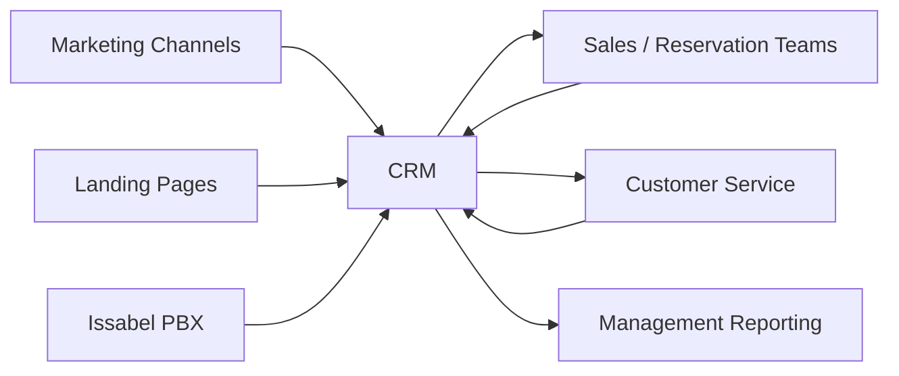

# Integration Architecture

## High-Level Flow

## Integration Objectives

- Centralize customer context.
- Reduce duplicate data entry.
- Improve traceability from acquisition to outcome.
- Give operational users access to the information needed for the next action.
- Create reliable reporting inputs.

## Design Consideration

Integration decisions were evaluated against implementation cost, data quality, operational dependency, and the business value of reducing manual steps.
